<!-- 1. Intro (DESIGNER: status pill, typing banner, role chip) -->
<picture>
  <source media="(prefers-color-scheme: dark)" srcset="./status_dark.svg">
  
</picture>

<!-- Typing banner (DESIGNER). Fallback if it is ever removed: tagline_dark/light.svg -->
<picture>
  <source media="(prefers-color-scheme: dark)" srcset="./banner_dark.svg">
  
</picture>

<picture>
  <source media="(prefers-color-scheme: dark)" srcset="./role_dark.svg">
  
</picture>

<!-- 2. Marquee (DESIGNER) -->
<picture>
  <source media="(prefers-color-scheme: dark)" srcset="./marquee_dark.svg">
  
</picture>

  

<h3><code>jatin@github ~ $ ./contributions.sh</code></h3>

<picture>
  <source media="(prefers-color-scheme: dark)" srcset="./contrib-heatmap_dark.svg">
  
</picture>

  

<h3><code>jatin@github ~ $ ./kpi --live</code></h3>

<picture>
  <source media="(prefers-color-scheme: dark)" srcset="./kpi_dark.svg">
  
</picture>

  

<h3><code>jatin@github ~ $ ls ./snippets</code></h3>

<picture>
  <source media="(prefers-color-scheme: dark)" srcset="./snippets_dark.svg">
  
</picture>

  

<h3><code>jatin@github ~ $ cat ./how-i-work.flow</code></h3>

<picture>
  <source media="(prefers-color-scheme: dark)" srcset="./how-i-work_dark.svg">
  
</picture>

  

<h3><code>jatin@github ~ $ ls ./skills --labels</code></h3>

<picture>
  <source media="(prefers-color-scheme: dark)" srcset="./skills_dark.svg">
  
</picture>

  

<picture>
  <source media="(prefers-color-scheme: dark)" srcset="./skills-globe_dark.svg">
  
</picture>

  

<h3><code>jatin@github ~ $ cat ./achievements.log</code></h3>

<picture>
  <source media="(prefers-color-scheme: dark)" srcset="./achievements_dark.svg">
  
</picture>

  

<!-- WHOAMI BLOCK: swap this table for DESIGNER's whoami file if one is handed over -->
<h3><code>jatin@github ~ $ whoami</code></h3>

<table>
  <tr>
    <td valign="top">
      <picture>
        <source media="(prefers-color-scheme: dark)" srcset="./portrait_dark.svg">
        
      </picture>
    </td>
    <td valign="top">
      <picture>
        <source media="(prefers-color-scheme: dark)" srcset="./info-card_dark.svg">
        
      </picture>
    </td>
  </tr>
</table>

 

<h3><code>jatin@github ~ $ ls ./featured</code></h3>

<picture>
  <source media="(prefers-color-scheme: dark)" srcset="./featured_dark.svg">
  
</picture>

<a href="https://money-tracker-mauve-kappa.vercel.app">money-tracker</a> ·
<a href="https://fitnessgym-gamma.vercel.app">FITNESSGYM</a> ·
<a href="https://portfolio-sage-mu-53.vercel.app">portfolio</a>

<!-- Images refresh daily via .github/workflows/refresh.yml -->
