<picture>
  <source media="(prefers-color-scheme: dark)" srcset="./tagline_dark.svg">
  
</picture>

  

<h3><code>jatin@github ~ $ ./contributions.sh</code></h3>

<picture>
  <source media="(prefers-color-scheme: dark)" srcset="./contrib-heatmap_dark.svg">
  
</picture>

  

<h3><code>jatin@github ~ $ ./kpi --live</code></h3>

<picture>
  <source media="(prefers-color-scheme: dark)" srcset="./kpi_dark.svg">
  
</picture>

  

<!-- HELD (how-i-work_*.svg): awaiting Jatin's keep/drop -->

<h3><code>jatin@github ~ $ ls ./skills --labels</code></h3>

<picture>
  <source media="(prefers-color-scheme: dark)" srcset="./skills_dark.svg">
  
</picture>

  

<picture>
  <source media="(prefers-color-scheme: dark)" srcset="./skills-globe_dark.svg">
  
</picture>

<!-- HELD (achievements_*.svg): awaiting Jatin's keep/drop -->

<h3><code>jatin@github ~ $ whoami</code></h3>

<table>
  <tr>
    <td valign="top">
      <picture>
        <source media="(prefers-color-scheme: dark)" srcset="./portrait_dark.svg">
        
      </picture>
    </td>
    <td valign="top">
      <picture>
        <source media="(prefers-color-scheme: dark)" srcset="./info-card_dark.svg">
        
      </picture>
    </td>
  </tr>
</table>

 

<!-- HELD (featured_*.svg): awaiting Jatin's keep/drop -->

